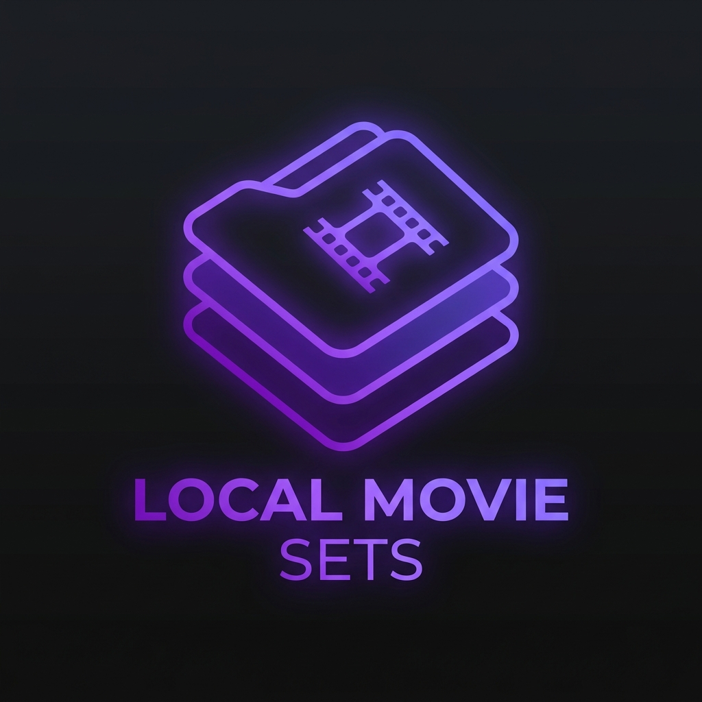
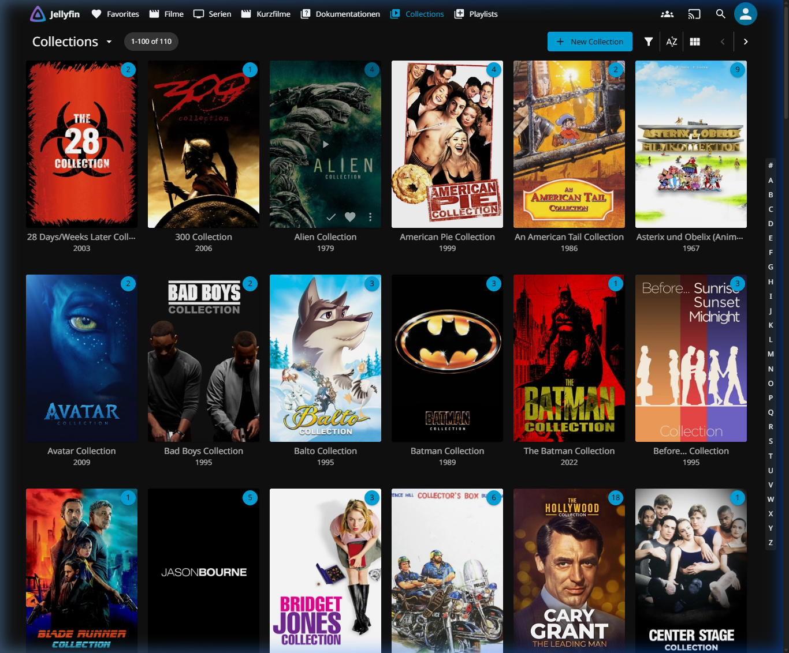
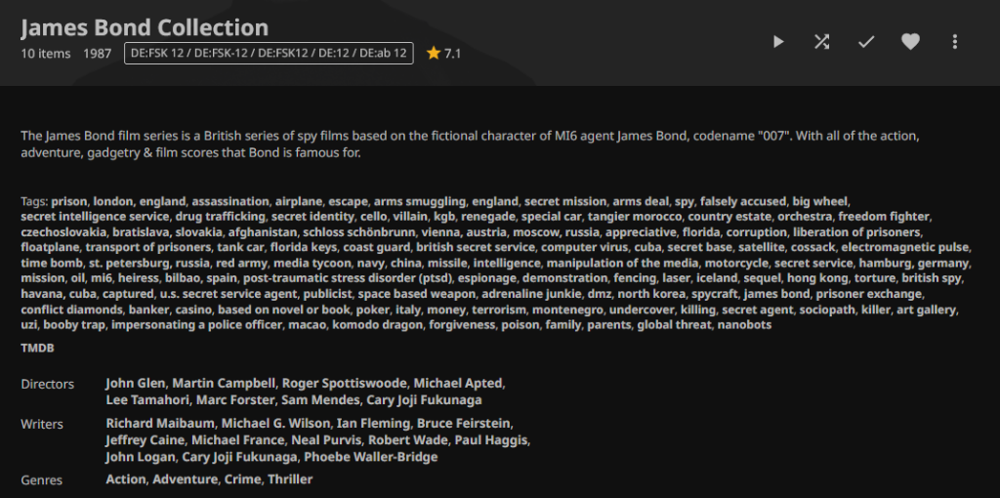
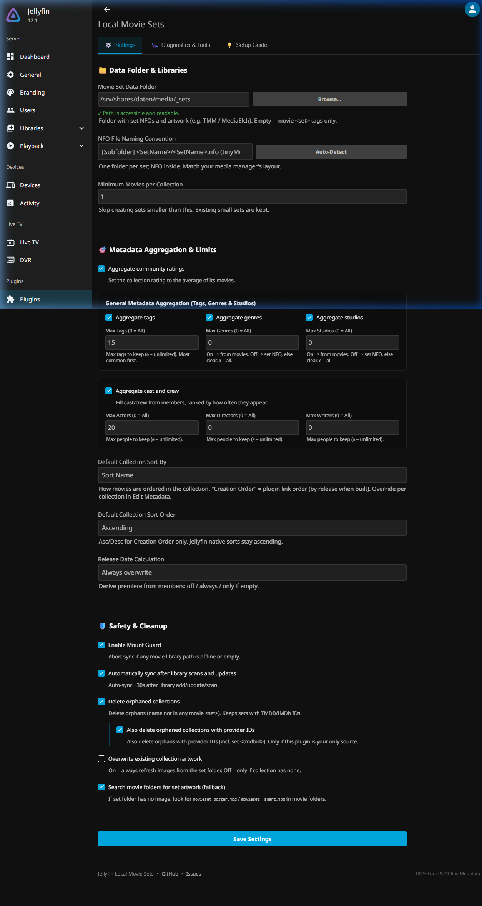
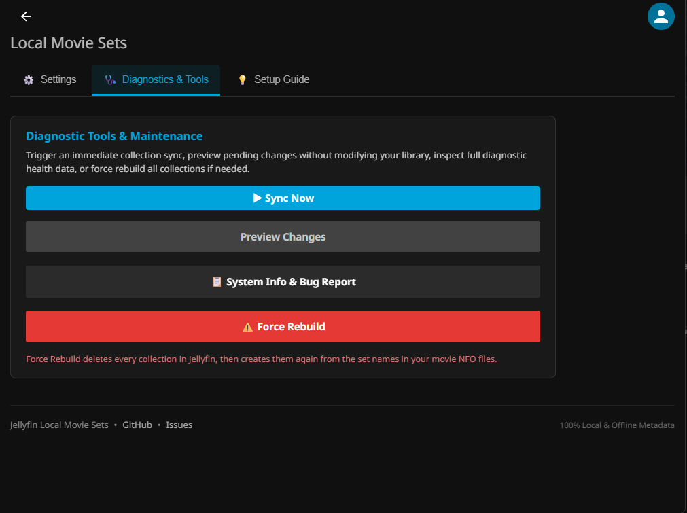
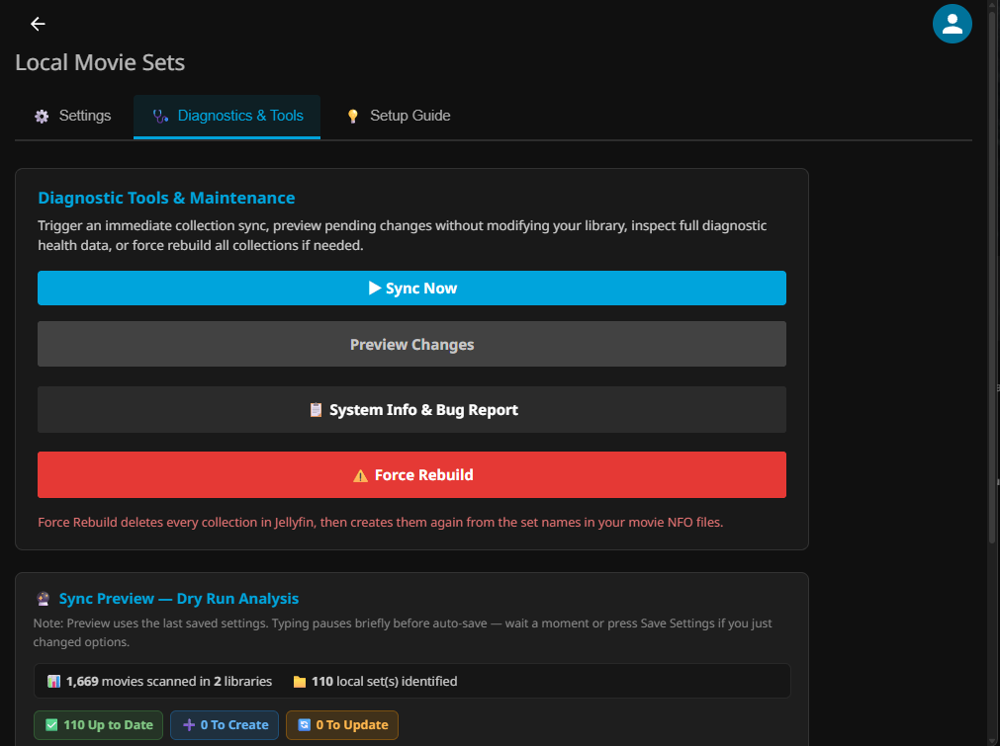
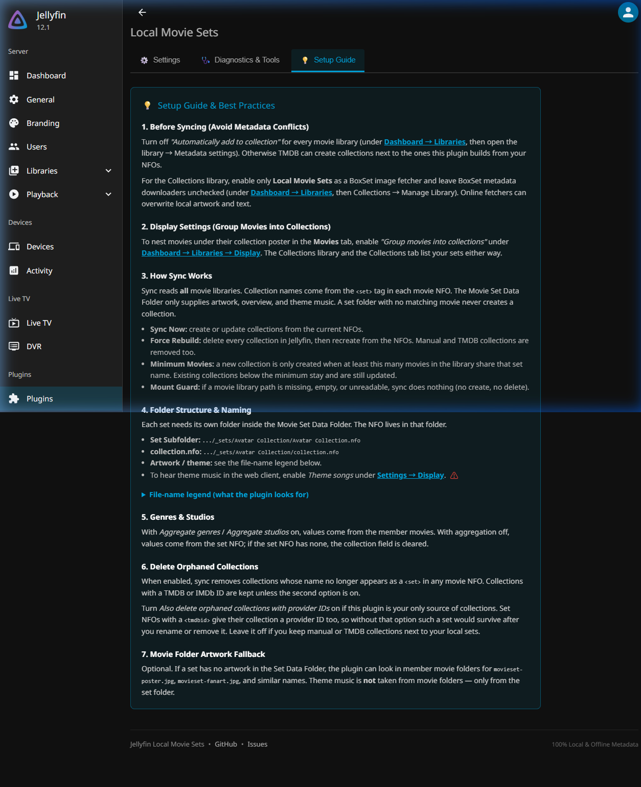

<div align="center">



# Jellyfin Local Movie Sets Plugin

[](LICENSE)
[](https://buymeacoffee.com/gitrys)
[](https://jellyfin.org)

**Creates and manages movie collections (box sets) in Jellyfin using 100% local metadata and artwork produced by media managers such as tinyMediaManager, MediaElch, or Kodi.**  
*Zero external API calls. Zero cloud telemetry. Completely offline and private.*

</div>

---

> [!NOTE]  
> **Vibe-Coded Project Notice**  
> This project is proudly **vibe-coded** — designed and developed through iterative AI-assisted pair programming between a human maintainer and an AI agent. It is crafted with love, rigorously validated against real-world media libraries containing hundreds of movie sets, and specifically engineered to solve genuine community needs that native Jellyfin metadata scrapers leave unaddressed.

---

## Contents

- [Overview](#overview)
- [Requirements](#requirements)
- [Installation](#installation)
- [Quick Start](#quick-start)
- [How It Works](#how-it-works)
- [Set Folder & File Names](#set-folder--file-names)
- [Settings](#settings)
- [Theme Music & Video](#theme-music--video)
- [Safety](#safety)
- [Diagnostics & Tools](#diagnostics--tools)
- [FAQ & Troubleshooting](#faq--troubleshooting)
- [Privacy](#privacy)
- [Development](#development)

---

## Overview

If you curate your media collection using media managers such as [tinyMediaManager (TMM)](https://www.tinymediamanager.org/), [MediaElch](https://mediaelch.github.io/mediaelch-doc/), Kodi, or hand-crafted `.nfo` files, you probably know the frustration: Jellyfin's default collection builder relies on online TMDB lookups, often creating mismatched sets, duplicate franchises, or ignoring your custom artwork and plots.

**Local Movie Sets** reads the metadata already sitting on your drives:

1. **Movie `.nfo` files:** the `<set><name>` tag in each movie's NFO decides which collection a movie belongs to, across **all** libraries.
2. **Movie Set Data Folder:** one subfolder per set with a set `.nfo` (overview, sort title, genres, studios, IDs), artwork, and optional theme music and theme video.
3. **Optional movie-folder artwork fallback:** member movie folders can supply `movieset-poster.jpg` and similar images when the set folder has none.

<div align="center">
  
  <p><em>Movie collections generated automatically from local metadata in Jellyfin.</em></p>
</div>

<div align="center">
  
  <p><em>Example: Alien Collection with plot, rating, tags, logo, and member movies populated entirely from local files.</em></p>
</div>

### Plugin configuration

<div align="center">

| ⚙️ Settings | 🩺 Diagnostics & Tools |
|---|---|
|  |  |

| 🩺 Dry-run Preview | 💡 Setup Guide |
|---|---|
|  |  |

<p><em>Three tabs: Settings, Diagnostics &amp; Tools (sync / preview / bug report / rebuild), and Setup Guide.</em></p>

</div>

---

## Requirements

- **Jellyfin 12.x.** The last build for Jellyfin 10.10 is [1.0.30.0](https://github.com/gitrys/jellyfin-local-movieset-addon/releases/tag/v1.0.30.0).
- Movie NFO files with a `<set>` tag (tinyMediaManager, MediaElch, Kodi, Ember, or hand-written).
- Optional: a Movie Set Data Folder with set NFOs and artwork, e.g. tinyMediaManager's movie set data folder.

---

## Installation

### Method A: Via Jellyfin Plugin Repository (Recommended)

1. Open your Jellyfin Web Interface as an administrator.
2. Navigate to **Dashboard → Plugins → Repositories**.
3. Click the **`+`** (Add) button and enter:
   - **Repository Name:** `Local Movie Sets`
   - **Repository URL:**
     ```text
     https://raw.githubusercontent.com/gitrys/jellyfin-local-movieset-addon/main/manifest.json
     ```
4. Click **Save**, then switch to the **Catalog** tab.
5. Locate **Local Movie Sets**, click **Install**, and restart your Jellyfin server.

### Method B: Manual Installation

1. Download the latest `Jellyfin.Plugin.LocalMovieSets_<version>.zip` from [GitHub Releases](https://github.com/gitrys/jellyfin-local-movieset-addon/releases).
2. Extract it into a folder `Local Movie Sets` inside the `plugins` folder of Jellyfin's data directory:
   - **Debian / Ubuntu package:** `/var/lib/jellyfin/plugins/Local Movie Sets/`
   - **Windows:** `%ProgramData%\Jellyfin\Server\plugins\Local Movie Sets\`
   - **Docker:** the `plugins` folder inside the volume you mounted as Jellyfin's config/data directory.
3. On Linux, make sure the files belong to the user Jellyfin runs as (e.g. `chown -R jellyfin:jellyfin ...`).
4. Restart Jellyfin.

---

## Quick Start

1. **Plugin settings:** enter the *Movie Set Data Folder* and choose the *NFO File Naming Convention*, or click **Auto-Detect**.
2. **Jellyfin library settings:**
   - Turn off **Automatically add to collection** for every movie library (**Dashboard → Libraries →** library **→ Metadata settings**). Otherwise TMDB creates collections next to yours.
   - For the Collections library, enable only **Local Movie Sets** as BoxSet image fetcher and leave the metadata downloaders unchecked.
   - The plugin page shows a red warning while one of these settings conflicts.
3. **Optional:** enable **Group movies into collections** under **Dashboard → Libraries → Display**, so set members appear under their collection poster in the Movies tab.
4. **Diagnostics & Tools:** run **Preview Changes** to see what a sync would do, then **Sync Now**. After that, syncs run automatically.

The **Setup Guide** tab in the plugin contains the same steps and the details below.

---

## How It Works

- **Membership** comes only from the `<set>` tag in each movie NFO (`<set><name>Alien Collection</name></set>`), across all libraries. The collection name is the set name. A set folder without a matching movie creates nothing.
- **When a sync runs:** about 30 seconds after movies are added, changed or removed (if *Automatically sync after library scans and updates* is on), every 24 hours as the scheduled task *Sync Local Movie Sets*, and with **Sync Now**. Movies added or removed while a sync runs trigger another sync right after it.
- **Plugin collections:** every collection the plugin manages carries the external ID *Local Movie Sets* (visible in Edit Metadata). A collection whose name matches a set is adopted and gets this ID. Orphan deletion and Force Rebuild only ever delete collections with this ID; set artwork and metadata are only applied to managed collections.
- **Minimum Movies per Collection:** a new collection is only created when at least this many movies share the set name. Existing collections below the minimum stay and are still updated.
- **Changed movie NFOs:** when a set member's NFO is newer than Jellyfin's stored item, the sync asks Jellyfin to re-read it (no online lookups; movie images are kept).
- **Collection metadata and artwork** are applied in Jellyfin's metadata refresh of each collection, which the sync queues.

### Collection metadata

| Field | Source |
|---|---|
| Name | Set name from the movie NFOs |
| Overview | Set NFO `<plot>` or `<overview>` |
| Original title, sort title | Set NFO `<originaltitle>`, `<sorttitle>` |
| TMDB / IMDb ID | Set NFO `<tmdbid>` / `<imdbid>` or `<uniqueid>` |
| Genres, studios | Member movies (aggregation on) or set NFO (aggregation off; a read NFO without values clears them, no readable NFO keeps them) |
| Community rating | Average of the members (aggregation on) |
| Tags, cast & crew | Ranked by how many members share them, with limits (aggregation on) |
| Release date / year | Oldest member movie (*Release Date Calculation*) |
| Artwork | Set folder, optional movie-folder fallback |

**Values the plugin never clears:** overview, original title, sort title, IDs, and aggregated rating, tags and people stay when the source has no value or aggregation is turned off. The plugin does not record which values it wrote, so clearing them could delete text you entered in Jellyfin. Clear such fields in Edit Metadata if needed.

---

## Set Folder & File Names

Each set needs its own folder directly inside the Movie Set Data Folder; the set NFO lives in that folder. NFOs in the root of the Movie Set Data Folder and nested set folders are not read.

| NFO File Naming Convention | Path pattern | Typical source | Example |
|---|---|---|---|
| **`[Subfolder] <SetName>/<SetName>.nfo`** *(default)* | `<SetFolder>/<SetName>/<SetName>.nfo` | tinyMediaManager | `_sets/Alien Collection/Alien Collection.nfo` |
| **`[Subfolder] <SetName>/collection.nfo`** | `<SetFolder>/<SetName>/collection.nfo` | MediaElch, Ember, Kodi | `_sets/Alien Collection/collection.nfo` |

Characters that are invalid in folder names may be replaced by `_`, a space, or left out; all three variants are found.

**In the set folder** (exact names):

| Type | File names |
|---|---|
| Poster | `poster.jpg/.png`, `folder.jpg/.png` |
| Fanart | `fanart.jpg/.png`, `backdrop.jpg/.png` |
| Logo | `logo.png/.jpg`, `clearlogo.png` |
| Thumb | `landscape.jpg/.png`, `thumb.jpg/.png` |
| Clearart, banner, disc, box, menu | `clearart.*`, `banner.*`, `disc.*` / `discart.*`, `box.*`, `boxrear.*` / `back.*`, `menu.*` |
| Theme music | `theme.mp3` (also `.m4a`, `.flac`, `.ogg`, `.wav`), or `{Folder}-theme.ext` / `{Folder}.theme.ext` |
| Theme video | `theme.mp4` (also `.mkv`, `.webm`, `.m4v`, `.mov`), or `{Folder}-theme.ext` / `{Folder}.theme.ext` |

**In member movie folders** (only with *Search movie folders for set artwork*, used for image types the set folder does not have): `movieset-poster`, `movieset-folder`, `movieset-fanart`, `movieset-backdrop`, `movieset-logo`, `movieset-thumb` and similar `movieset-*` names, or the same names with the set name instead of `movieset` (e.g. `Alien Collection-poster.jpg`). Theme music and video are never taken from movie folders.

**Stacked movie files** (`Alien-cd1.mkv`) also find an NFO named without the part marker (`Alien.nfo`).

---

## Settings

Settings save automatically after a short pause; **Save Settings** saves immediately.

| Setting | Default | What it does |
|---|---|---|
| Movie Set Data Folder | empty | Folder with one subfolder per set. Saved when you leave the field. |
| NFO File Naming Convention | `<SetName>/<SetName>.nfo` | Which set NFO name the plugin reads; **Auto-Detect** checks your folder. |
| Minimum Movies per Collection | 1 | Movies a set needs before a new collection is created. |
| Aggregate community ratings | off | Collection rating = average of the members. |
| Aggregate tags / genres / studios | off | Values from the member movies, with a limit each (`0` = all). |
| Aggregate cast and crew | off | Actors, directors and writers from the members, with limits (`0` = all). |
| Default Collection Sort By | Release Date | Display order set when the plugin takes over a collection; an order chosen in Edit Metadata is kept. **Apply to all plugin collections** sets it everywhere. |
| Release Date Calculation | Do not calculate | *Always overwrite* or *Set only if empty* dates a collection from its oldest member. |
| Enable Mount Guard | on | No sync while a movie or mixed library root is missing, empty or unreadable. |
| Automatically sync after library scans and updates | on | Sync about 30 seconds after movie changes in the library. |
| Delete orphaned collections | off | Delete plugin collections whose set no longer appears in any movie NFO (asks for confirmation). |
| Orphan cleanup limit | 25 % | If one sync would delete more than this share of plugin collections (and at least 5), it deletes nothing and warns. `0` = no limit. |
| Overwrite existing collection artwork | off | Replace existing collection images with set-folder images. Missing images are always filled in. |
| Search movie folders for set artwork (fallback) | on | Use `movieset-*` images from member movie folders. |

---

## Theme Music & Video

- The plugin copies theme music into Jellyfin's collection folder (`theme.<ext>`) and the theme video into its `backdrops` subfolder, where Jellyfin looks for theme videos.
- Enable **Theme songs** and **Theme videos** in **Settings → Display** of the Jellyfin web client. These settings are stored per browser. When theme videos are on and a collection has one, the web client plays the video instead of the song.
- When a theme is removed from the set folder, its copy is removed on the next sync. While the Movie Set Data Folder is not configured or not reachable, copies are kept.
- Theme videos take space in Jellyfin's data folder (often tens of MB each).

---

## Safety

- **Mount Guard** (on by default) checks the root of every movie and mixed library before a sync. If a root is missing, empty or unreadable, the sync does nothing.
- **Unreadable NFO or missing movie file** (media manager writing the file, share or mount point offline): the movie stays in its current collection, and the sync log names it.
- **Movie Set Data Folder offline:** members are still updated; collection text, artwork and theme copies stay unchanged, and the sync log shows a warning.
- **Orphan deletion** is off by default, asks for confirmation, only deletes plugin collections, and is limited per sync (see [Settings](#settings)).
- **Force Rebuild** deletes the plugin's collections and recreates them from the NFOs; manual and TMDB collections stay. **Delete ALL Collections & Rebuild** deletes every collection in Jellyfin first. With Mount Guard on, both check the library roots before deleting anything.

---

## Diagnostics & Tools

| Tool | What it does |
|---|---|
| **Sync Now** | Runs a sync immediately (waits if one is running). |
| **Preview Changes** | Dry run: collections to create, update and delete, sets below the minimum, warnings. Changes nothing. |
| **System Info & Bug Report** | Runs the preview, an NFO/artwork check of the Movie Set Data Folder and health checks, and builds a report for a GitHub issue (see [Privacy](#privacy)). |
| **Force Rebuild** | Deletes and recreates the plugin's collections. |
| **Delete ALL Collections & Rebuild** | Deletes every collection in Jellyfin, then rebuilds from the NFOs. |

Sync results and warnings also appear in Jellyfin's activity log (**Dashboard → Activity**).

---

## FAQ & Troubleshooting

### Why do I see duplicate collections?
You likely have Jellyfin's **Automatically add to collection** option enabled on one or more libraries, so TMDB creates online box sets next to your local ones. Disable it, then delete the TMDB duplicates in Jellyfin. **Force Rebuild** leaves them alone; **Delete ALL Collections & Rebuild** removes every collection and rebuilds from your NFOs.

### A set has no collection.
Run **Preview Changes**. The set may be below *Minimum Movies per Collection*, or the movies use different `<set>` names (the comparison ignores upper and lower case, but not spelling).

### A collection has no poster or the wrong artwork.
Open **System Info & Bug Report**: its NFO/artwork check lists set folders without usable images and files the plugin does not read (for example `cover.jpg`). Existing images are only replaced with *Overwrite existing collection artwork*. Also check the red warning about BoxSet image fetchers on the plugin page.

### Theme music or video does not play.
Enable **Theme songs** / **Theme videos** in **Settings → Display** in the browser you use. If the copy was just made, Jellyfin may pick it up on the next sync.

### Will my collections disappear if my network drive unmounts?
No. See [Safety](#safety): Mount Guard stops the sync, and movies whose files are missing keep their collection.

### Does this plugin modify any of my media files?
Your movie and set `.nfo`, video, and image files are only read. Theme audio and theme videos are copied into Jellyfin's own collection folder, and these copies are removed when the theme is no longer in the set folder. If Jellyfin's own NFO saver is enabled for a library, Jellyfin still writes NFO files when you edit metadata in Jellyfin; a sync by this plugin does not trigger that. **Force Rebuild** and orphan deletion remove the plugin's Jellyfin collection folders, not your media files.

### How do I report a bug?
Open **System Info & Bug Report**, keep *Mask File Paths* on (and *Mask Set & Movie Titles* if you like), copy the text, and paste it into a [bug report](https://github.com/gitrys/jellyfin-local-movieset-addon/issues/new/choose).

---

## Privacy

- The plugin makes no outbound calls: no TMDB, no telemetry, no update checks.
- The bug report is built on your own Jellyfin server and only leaves it when you copy it. *Mask File Paths* (on by default) shortens every absolute path and replaces library folders and the set data folder with placeholders; *Mask Set & Movie Titles* replaces every collection, set, and movie name the server knows with `[Set n]` / `[Movie n]` (movie titles shorter than 3 characters stay).

---

## Development

Requirements: [.NET 10 SDK](https://dotnet.microsoft.com/download).

```bash
git clone https://github.com/gitrys/jellyfin-local-movieset-addon.git
cd jellyfin-local-movieset-addon

# Build
dotnet build Jellyfin.Plugin.LocalMovieSets.sln -c Release

# Run the tests
dotnet test Jellyfin.Plugin.LocalMovieSets.sln -c Release

# Build the plugin files into ./publish
dotnet publish Jellyfin.Plugin.LocalMovieSets/Jellyfin.Plugin.LocalMovieSets.csproj -c Release -o publish
```

| Path | Contents |
|---|---|
| `Jellyfin.Plugin.LocalMovieSets/Services/` | Sync, delete, preview, Force Rebuild, bug report masking |
| `Jellyfin.Plugin.LocalMovieSets/Providers/` | Collection metadata and image providers (Jellyfin refresh pipeline) |
| `Jellyfin.Plugin.LocalMovieSets/Parsers/` | Movie and set NFO parsing |
| `Jellyfin.Plugin.LocalMovieSets/Api/` | Admin endpoints for the settings page |
| `Jellyfin.Plugin.LocalMovieSets/Configuration/configPage.html` | Settings page (single HTML file, embedded) |
| `Jellyfin.Plugin.LocalMovieSets.Tests/` | xUnit tests |

**Releases:** pushing a tag `v<version>` (e.g. `v1.0.38.0`) runs the release workflow. It builds the plugin ZIP, publishes a GitHub release with the matching [CHANGELOG](CHANGELOG.md) section, and updates `manifest.json` for the plugin catalog.

Bug reports and feature requests are welcome as [GitHub issues](https://github.com/gitrys/jellyfin-local-movieset-addon/issues/new/choose).

---

## Support & Buy Me a Coffee

If this plugin saves you time and keeps your movie collections organized, feel free to support development:

[](https://buymeacoffee.com/gitrys)

---

## License

This project is licensed under the **MIT License** — see the [LICENSE](LICENSE) file for details.
